# Noviqa repository merge QA, 12 November 2026

Result: **passed for merging the current prototype**. No blocking functional, packaging or responsive defects were found in the tested scope. This is not production-launch or accessibility certification.

## Scope and evidence

Reviewed the current `index.html`, its byte-identical `preview.html`/`workflow-demo.html` aliases, build compatibility, selected Converge branding, standalone delivery, frozen simpler-site archive, separate logo comparison, source changes and documentation. User-approved scope is to push and merge all current website changes, not configure hosting, domain/DNS, enquiry services or legal policies.

All screenshots below were captured in this QA run by Chromium/Playwright from the actual standalone index with networking disabled, opened and visually inspected before acceptance. Desktop viewport: 1440 × 1000 CSS pixels; mobile: 390 × 844; density 1 and reduced motion enabled. Workflow result screenshots intentionally show the result-focused scroll position inside the dialog, with persistent header/review controls. They are not full-scroll inventories of every field.

Machine-readable results: [checks.json](qa/2026-11-12/checks.json). Fresh evidence is committed with this report so it remains available after the cloud workspace ends.

## Audit steps

| Step | Checked state | Health and finding |
|---|---|---|
| 1 | Desktop homepage/navigation | Passed. Converge, hierarchy and CTAs render correctly; skip link works. |
| 2 | Enquiries, complete | Passed. Draft and simulated follow-up retain human review and no-send wording. |
| 3 | Enquiries, missing details | Passed. Missing information routes to clarification, not an invented quote. |
| 4 | Documents, complete | Passed. Source checks and AUD 528 draft are clearly not a posted invoice. |
| 5 | Documents, missing references | Passed. Entry is held for review; unknown currency/order is not silently filled. |
| 6 | Reporting, complete | Passed. Sample totals/comparison and confirmed-job matches are consistent. |
| 7 | Reporting, missing value | Passed. Total and growth comparison are withheld pending correction. |
| 8 | Approach section | Passed. Separate scope/fees, standalone audit value and readable deliverables remain clear. |
| 9 | Mobile homepage | Passed. No logo/menu collision or horizontal overflow. |
| 10 | Mobile navigation | Passed. Expansion state and navigation close behavior work. |
| 11 | Mobile reporting exception | Passed. Prepared work comes first; review controls remain available. |
| 12 | Contact input/validation | Passed for the local composer. Whitespace is rejected; no claim of sending. |
| 13 | Prepared brief/edit | Passed. Text is retained, edit restores focus, and nothing-sent status is explicit. |
| 14 | Privacy and terms | Passed for preview disclosure. Both dialogs open/close; final legal policies are still a launch gap. |

### 1. Desktop entry

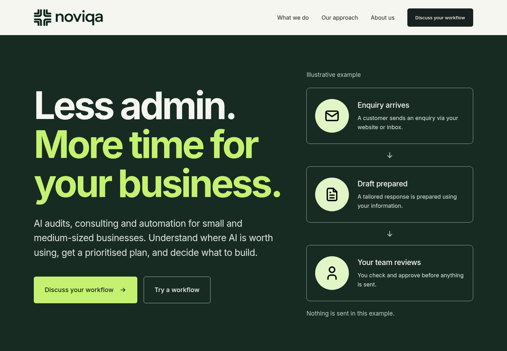

### 2–7. Workflow cases

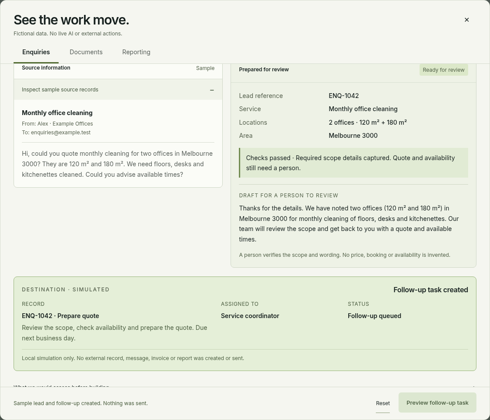

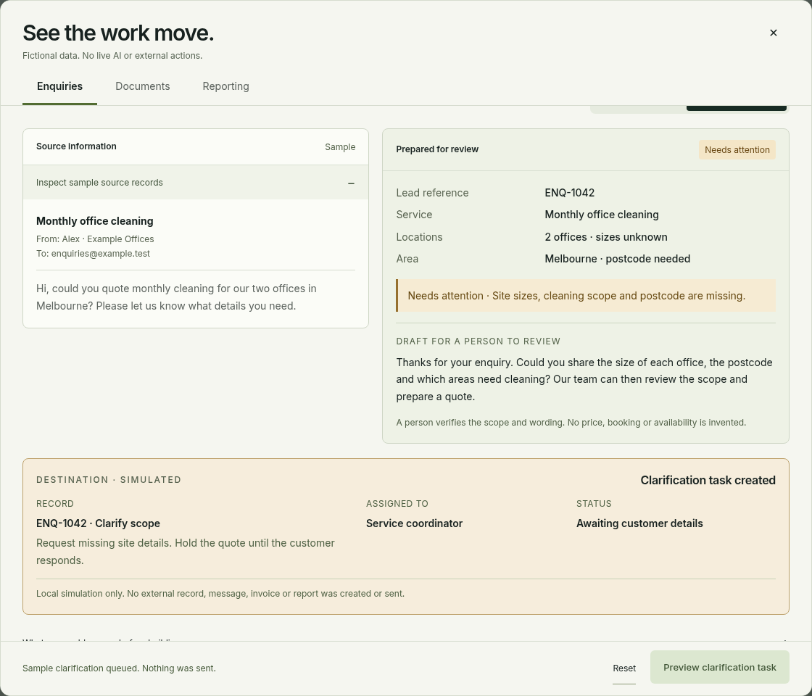

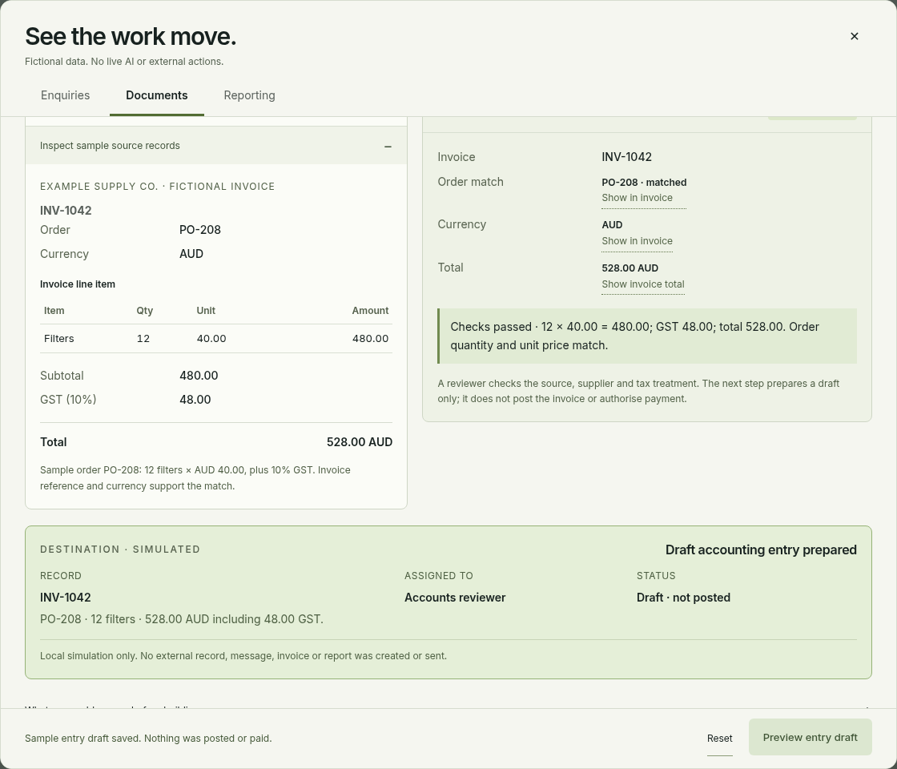

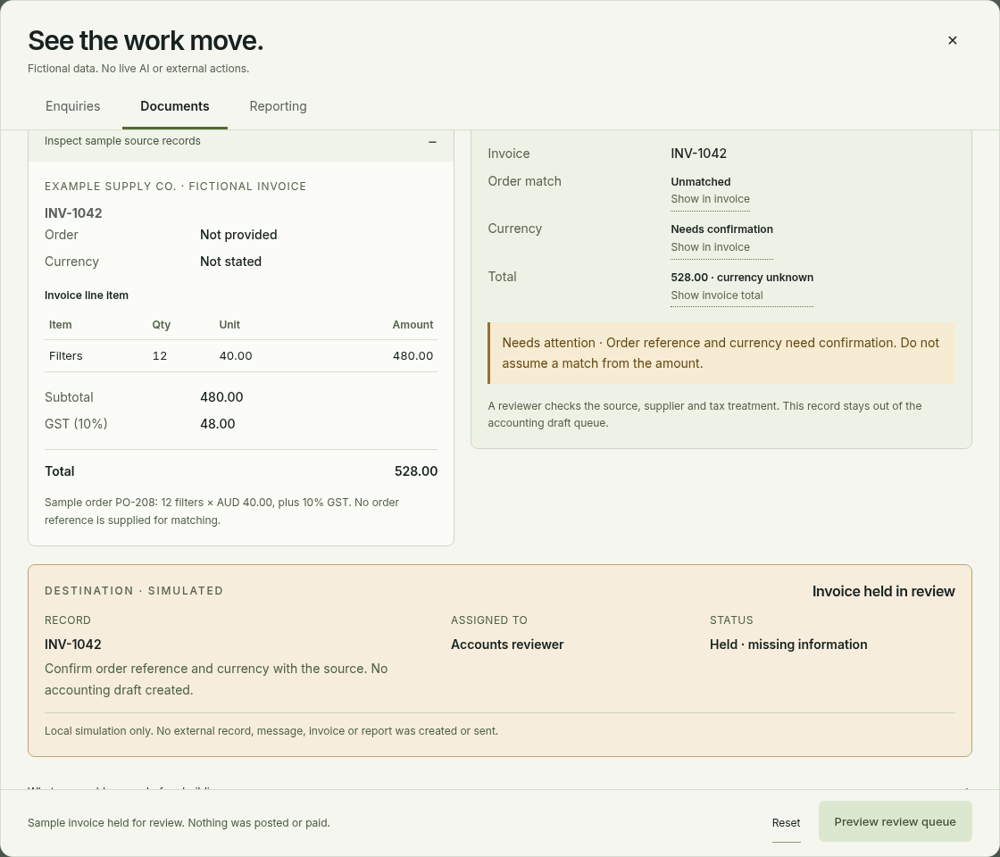

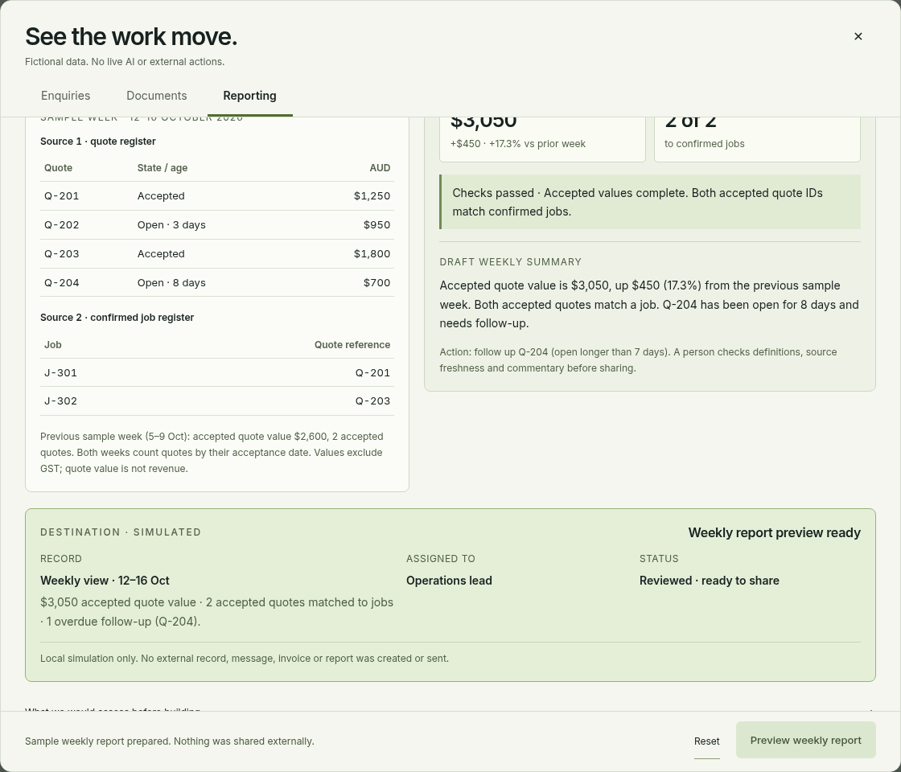

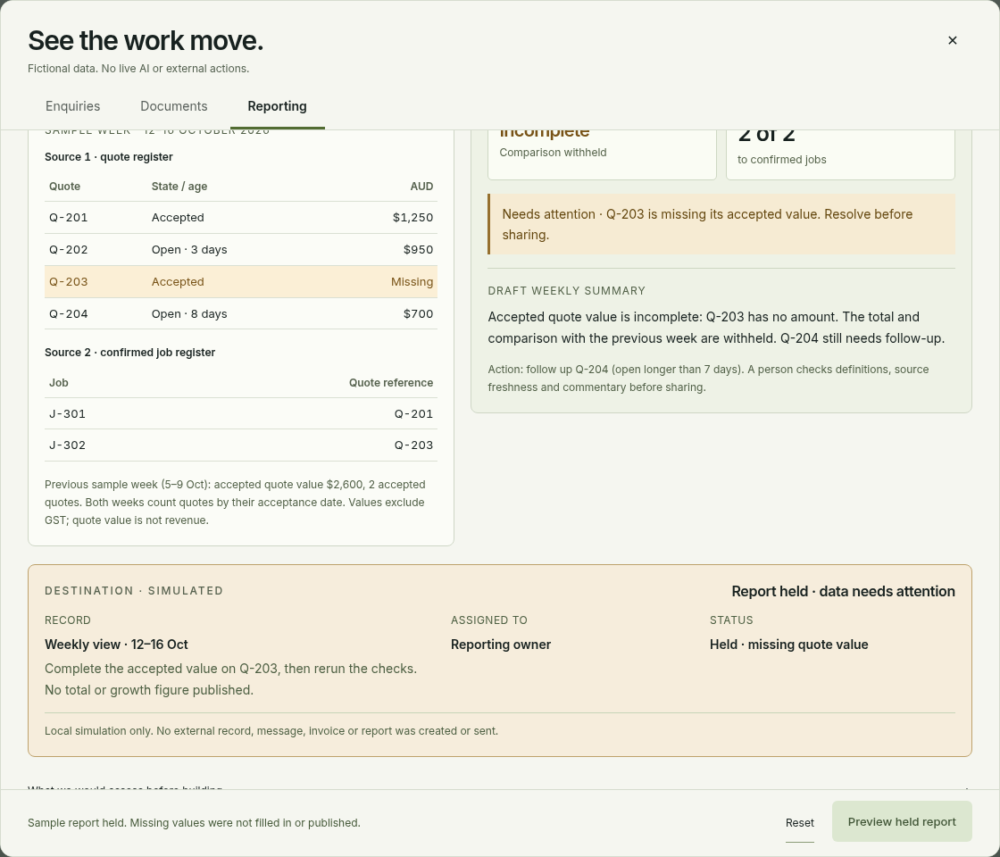

### 8. Approach

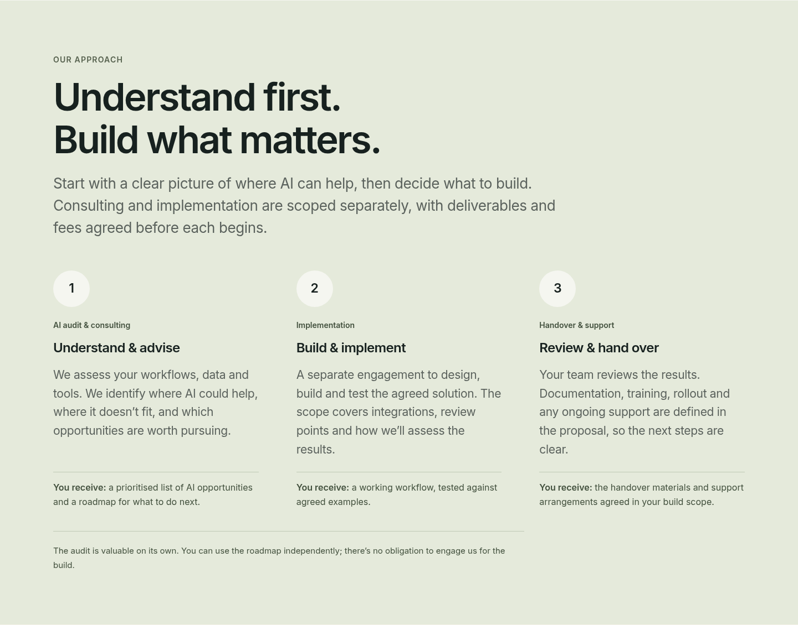

### 9–11. Mobile entry and workflows

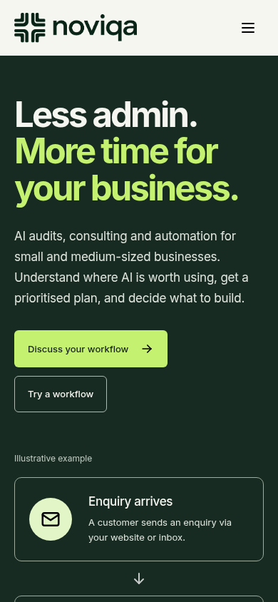

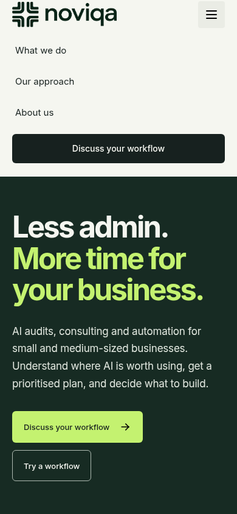

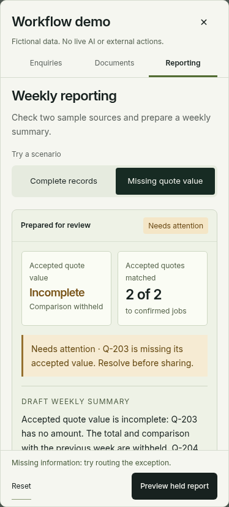

### 12–14. Local contact and policy states

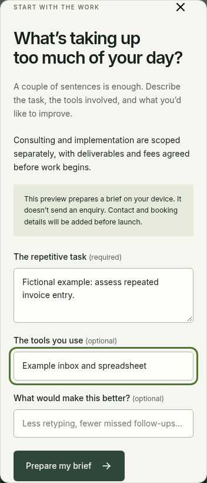

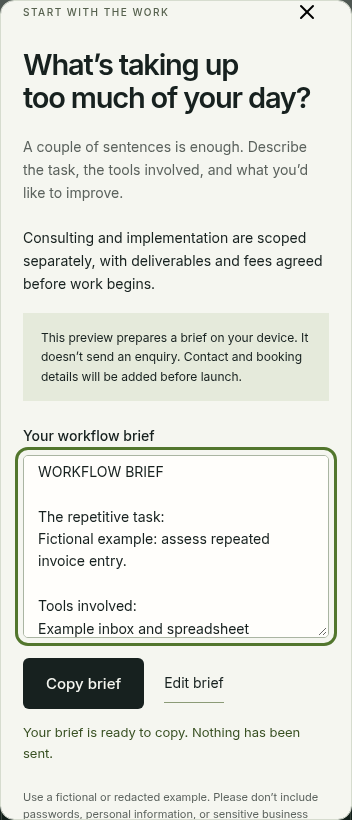

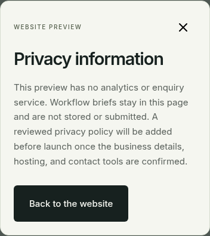

## Automated verification

- 15 Node tests passed: one canonical richer build, all-entry equality, embedded resources, archive checksum, Converge identity, approved content, comparison separation and compatibility API.
- All six workflow cases passed in each of `index.html`, `preview.html` and `workflow-demo.html` (18 entry/case combinations), with source highlighting, arithmetic, reset, keyboard tabs, Escape/focus return and responsive overflow checks.
- Brand checks passed 42 combinations: three entries, seven widths (1440/1024/900/768/700/390/320) and scripts enabled/disabled. No broken logo images, collisions, console errors or external requests.
- Mobile polish passed 12 cases at 390 × 844 and 320 × 568, including resize state preservation, 14px reading text, minimum 12px secondary explorer text and visible actions. Desktop service links/deliverables remained aligned.
- Approach checks retained 14px section/stage labels and 16px deliverables at all tested widths.
- Separate logo-comparison tests passed both identities, their six workflow cases and 14 responsive logo layouts.
- Fresh release check passed 14 captured states, required-field/whitespace validation, prepared-brief/edit, privacy/terms, skip link, one h1, unique IDs, valid ARIA ID references and valid fragment links. No console/page errors or external requests.
- JavaScript syntax, build freshness, compatibility build command and Git whitespace checks passed. The new terms assertion was made case-insensitive to match the existing valid "Website terms" heading; no application change was needed.

## Content and accessibility assessment

The homepage accurately presents AI auditing/consulting and a separately scoped build. It preserves independent audit value, agreed fees, human review and clearly fictional examples without adding clients, savings, credentials or service guarantees. Brand/font spacing and the approved technical illustration are retained.

Basic keyboard, focus, semantic-reference, responsive and reading-size checks passed. No new automated axe result is claimed: the optional axe package is not installed and no dependency was added. Manual screen-reader, real-device/virtual-keyboard, browser-chrome favicon and complete WCAG evaluation remain separate checks. Small contact fine print and scrolling on narrow screens should receive real-device review before launch.

## Known launch gaps, not regressions

1. The contact control is still a local brief composer. Actual enquiry delivery to `info@noviqa.com.au` requires the approved form endpoint/service and an end-to-end delivery test.
2. Final privacy/terms, hosting/domain setup and production metadata need confirmation. This merge does not configure these services.
3. The selected logo uses tested raster assets. Editable vector masters, font licensing and trademark/similarity clearance remain outstanding.

These limits are visible in the prototype and project documentation. The QA result authorizes proceeding with the requested repository merge, not describing the site as production-ready.

## Reproduction commands

```sh
node scripts/build-preview.mjs --check
node scripts/build-logo-comparison.mjs --check
node --test scripts/build-preview.test.mjs scripts/build-workflow-demo.test.mjs scripts/build-logo-comparison.test.mjs
node scripts/check-preview.cjs
node scripts/check-workflow-demo.cjs index.html
node scripts/check-workflow-demo.cjs preview.html
node scripts/check-workflow-demo.cjs workflow-demo.html
node scripts/check-brand.cjs
node scripts/check-polish.cjs
node scripts/check-approach.cjs
node scripts/check-logo-comparison.cjs
node scripts/check-release.cjs
git diff --check
```

The browser checks require the environment's existing Playwright and `/usr/bin/chromium`; they are not shipped website dependencies. `check-release.cjs` refreshes this dated QA evidence and contains fictional test input only.
